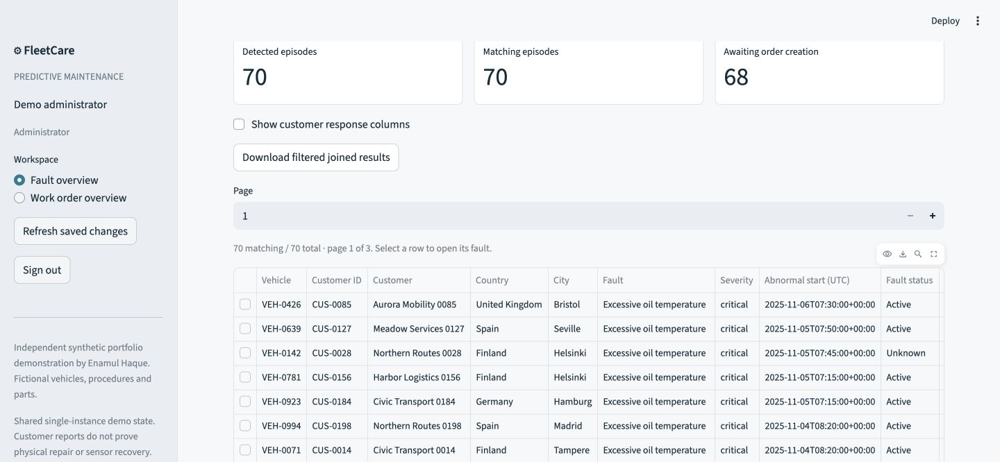
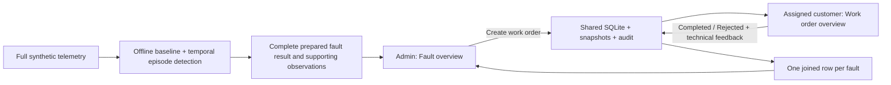

# FleetCare — Predictive Maintenance

A synthetic maintenance workflow by **Enamul Haque**, with two workspaces:

**Complete detected-fault dataset → administrator reviews evidence → Create work order → assigned customer reads actions/parts → Completed or Rejected response → the same fault row shows the response.**

[Repository](https://github.com/Enamul22/FleetCare-PredictiveMaintenance) · Python 3.12 · Streamlit · SQLite · pandas/Parquet · scikit-learn · Plotly. Public package version remains **1.0.0**; entry point remains **app.py**.



All vehicles, customers, telemetry, locations, workshop procedures, parts and outcomes are based on synthetic data. This
is an independent portfolio demonstration, with no company affiliation or real customer integration.
No paid API is needed. No open-source licence grant has been selected.

## Install and launch

```bash
git clone https://github.com/Enamul22/FleetCare-PredictiveMaintenance.git
cd FleetCare-PredictiveMaintenance
python3.12 -m venv .venv
source .venv/bin/activate
pip install -r requirements.lock.txt
streamlit run app.py
```

The clean-clone path uses prepared results and frozen baseline coefficients. It does **not** generate,
train or detect the whole fleet on startup. Pinned direct dependencies are in requirements.txt; the tested
transitive environment is in requirements.lock.txt. Public version/name were not changed for this update.

## Sign in and review the workflow

Local synthetic demo credentials are intentionally public:

| Account | Email | Password |
|---|---|---|
| Administrator | `admin@fleetcare.example` | `fleetcare-admin-demo` |
| Example customer | `customer0000@fleetcare.example` | `fleetcare-customer-demo` |
| Any assigned synthetic customer | `customerXXXX@fleetcare.example`, using its four-digit customer ID | `fleetcare-customer-demo` |

These are fictional demonstration accounts, not Enamul's real credentials. Use private account
configuration before restricting a hosted review; see [deployment and authentication](docs/DEPLOYMENT.md).

1. Sign in as administrator. **Fault overview** immediately shows the complete 70-episode result from
   1,000 vehicles, 1,931,280 detailed observations, October–December 2025. Counts are measured, not a target.
   Search/filter/sort, move between pages, or download all filtered joined rows. There is no hidden row cap.
2. Select a table row. Review its actual supporting sensor observations, healthy expected baseline,
   warning/critical boundaries, abnormal start and first persistence confirmation. Review the nested
   **Recommended actions** and **Parts list** tabs. Candidates do not prove a unique cause.
3. Choose **Create work order**. Detection alone creates no export request or order. The selected order
   saves its customer assignment, recommendation, parts, policy and baseline snapshot. Repeated creation
   returns the same ID. Failure is recorded as Failed, with a safe retry; other faults remain uncreated.
4. Open a second browser tab and sign in as that assigned customer. The fault detail shows its demo email.
   For example, the newest prepared fault belongs to `CUS-0085` / `customer0085@fleetcare.example`.
   **Work order overview** defaults to Open and shows only that account's orders. Refresh saved changes
   requeries shared state without restarting. Another customer cannot access the order or its evidence.
5. Select the order. Read its exported actions/parts. Choose **Completed** or **Rejected**. Completed
   retains technical finding, optional confirmed cause (Unknown allowed), actual action/compatible parts,
   reported resolution, optional rating and notes. Rejected requires a reason and omits work-performed
   fields. There is one final submit; no Assign/Start, inventory/reservation, ERP receipt or replay steps.
6. Refresh the administrator's fault view. The same fault row/detail shows the exact customer response.
   Completed/Rejected orders remain readable in history. Completed with **Not resolved** is valid and
   does not change sensor-derived fault status. Notes, including the word “partial”, have no simulation effect.

An empty customer account is a valid state: orders appear only after explicit creation for that account.
Back from a fault preserves filters and page position. Optional response columns and filtered CSV include
technical feedback, timestamps, rating and rejection reason; null feedback is empty, never a zero rating.

## Shared saved state and authorization

The default is shared SQLite at `fleetcare.sqlite`, with WAL, transactional writes, opaque expiring
sign-in sessions, service-enforced roles/ownership, and unique order/response keys. Admin and customer
sessions see each other's saved workflow changes through fresh queries. Local records survive restart.
Only a customer's assigned orders and linked evidence are available to their authenticated session;
passing another ID or an editable role assertion does not grant access.

```bash
FLEETCARE_DB=/absolute/path/fleetcare-review.sqlite streamlit run app.py
```

The two workspaces share a configured store; there is no per-browser seed/reset database. Reset/reseed is
an explicit offline development action, never a customer control. Existing legacy tables/audit are preserved
by an additive migration. Legacy assigned/in_progress map to Open; completed maps to Completed; cancelled
maps to Rejected with its original legacy state retained. Missing customer decisions/end times are not invented.
Legacy technical feedback remains separately readable by administrators.

This is a modest **single-instance synthetic demonstration**, not production identity management or a
production multiuser service. Demo passwords are public by design. Hosted local files can be lost on sleep,
restart or redeployment and cannot coordinate separate replicas. Reliable hosted durability requires a future
external store configuration/implementation; no external durable backend or OIDC integration is claimed.

## Complete detection dataset and reproducibility

The offline pipeline processed every configured vehicle's full Q4 detailed telemetry. It produced **70**
unique episodes, with no sampling/truncation. The current gradual-degradation source has no simulated
maintenance resets, so its 70 episodes are Active or Unknown; Ended/recurrence handling is verified against
separate sensor-evidence fixtures rather than fabricating extra fleet rows.

The package includes all 1,000 assets, 365,000 daily summaries, 12,000 derived monthly usage summaries,
1,000 prior service records, 64 fictional part variants, all 70 fault rows, and the Q4 observations for every
vehicle with a fault. The entire raw fleet telemetry is generated separately, not committed. Every fault's
support is retrievable; manifests list counts, coverage, source partition hashes and packaged checksums.

```bash
export PYTHONPATH=src
# Full fleet source generation; may take several minutes, never run on app startup.
python -m fleetcare.simulation --full --output data/full/update
# Materialize the complete result and supporting observations.
python -m fleetcare.pipeline --source data/full/update --output data/demo
# Separate held-out evaluation; uses frozen regression and development-only challenger fitting.
python -m fleetcare.evaluation
# Isolated temporary-store admin/customer acceptance run.
python -m fleetcare.verify
pytest -q
ruff check .
ruff format --check .
```

Interval support now uses consecutive engine-on timestamp intervals no longer than ten minutes, with
no extrapolation after a terminal sample. Daily and detailed counters share exact day boundaries.
Batch detection uses bounded temporal windows, not a per-observation reload of the full history.
Country weather still follows the same fictional seasonal formula; January–September condition summaries
remain independent approximations. Q4 daily values derive from detailed telemetry. These limitations are
explicit; no monthly health or peer scoring is implemented.

## Measured evaluation

A newly reserved test cohort (160 vehicles, seed 20261024) contains **61 labelled events** over
**633.333 supported operating hours**. Event matching has stable IDs, explicit onset/end windows,
independent recurrences and separate duplicate/early/late alert accounting. Hash-seed reproducibility
is tested across separate Python processes. Thresholds and the healthy baseline were not tuned on this test.

| Method | Event recall | False incidents | Median delay | Duplicate alerts |
|---|---:|---:|---:|---:|
| Contextual temporal rules | 53/61 (86.9%) | 0 | 45 min | 0 |
| Isolation Forest, generic anomalies | 27/61 (44.3%) | 6 | 45 min | 3 |
| Simple raw limits | 51/61 (83.6%) | 7 | 35 min | 17 |

Rules warned before the separately defined later failure onset in **3/3 supported synthetic events**
(median lead 45 minutes). Three events cannot establish real-world advance prediction. Zero observed
false incidents also does not prove a zero population rate. See [evaluation report](docs/TESTING.md) for
family denominators, uncertainty, exposure definitions and misses. Isolation Forest remains offline.
Historical results from commit bbcab56 are retained under evaluation/historical and are not directly
comparable with the corrected/new test cohort.

## Architecture and further documentation



- [Architecture and migration](docs/ARCHITECTURE.md) · [Data dictionary](docs/DATA_DICTIONARY.md)
- [Dataset/simulator card](docs/DATASET_CARD.md) · [Detector/model card](docs/MODEL_CARD.md)
- [Five playbooks](docs/PLAYBOOKS.md) · [Tests and evaluation](docs/TESTING.md)
- [Updated review screenshots](docs/evidence/README.md) · [Progress record](docs/PROGRESS.md)
- [Manual deployment/authentication checklist](docs/DEPLOYMENT.md)

ServicePlan scheduling and FleetPulse scoring remain future projects. Shared schemas/histories are
preserved; no scheduler, overall condition score, peer percentile engine or portfolio website is included.
