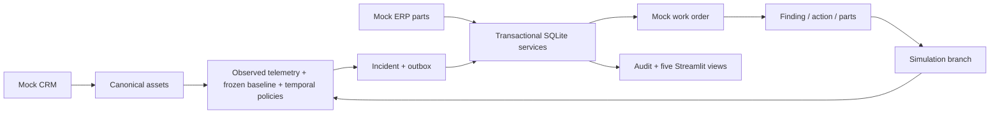

# FleetCare — Predictive Maintenance

A working synthetic fleet-maintenance application by **Enamul Haque**: observed telemetry → persistent
abnormal-condition evidence → incident → mock work order → compatible parts → technician feedback →
subsequent sensor verification.

[Repository](https://github.com/Enamul22/FleetCare-PredictiveMaintenance) · Python 3.12 · Streamlit ·
SQLite · pandas/Parquet · scikit-learn · Plotly


FleetCare demonstrates operational integration and writeback for a fictional 1,000-vehicle petrol fleet.
All vehicles, customers, sensor readings, countries' operating assumptions, procedures, SKUs, prices and
outcomes are synthetic. This is an independent portfolio project, with no Metso/OEM affiliation or
production deployment. It contains no real customer information or employer code. No licence grant has
been selected; all rights are reserved pending Enamul's choice.

## Run locally

Use Python **3.12**. A clean clone needs no API key, private file, training job or external database.

```bash
git clone https://github.com/Enamul22/FleetCare-PredictiveMaintenance.git
cd FleetCare-PredictiveMaintenance
python3.12 -m venv .venv
source .venv/bin/activate
pip install -r requirements.lock.txt
streamlit run app.py
```

`requirements.txt` contains pinned direct dependencies for Streamlit Community Cloud; the tested
transitive environment is pinned in `requirements.lock.txt`. The entry point is **`app.py` at repository
root**. The bundled data and coefficients are loaded immediately; full generation never runs on startup.

Default mode gives each visitor an isolated, temporary SQLite database. Reset demo clears that visitor's
operational history; browser-session loss may also discard it. For single-operator local persistence:

```bash
FLEETCARE_MODE=local FLEETCARE_DB=./fleetcare.sqlite streamlit run app.py
```

Local records survive app/process restarts. Public hosted mode must remain `session`: hosted filesystem
writes are not promised durable, private across visitors, or suitable as a shared multiuser backend. No
external durable store is implemented. Its adapter/authentication/transaction design is a future extension.

## Guided demonstration

1. **Fleet overview:** filter model, country, month and severity. Hours derive from the selected monthly
   usage dataset. Incident counts derive from the currently replayed state, not estimated fleet prevalence.
2. **Asset investigation → Guided replay:** choose FC-01 and advance by 60 minutes. Startup readings
   are excluded. Inspect measured sensor, healthy expected baseline, warning boundary and incident marker.
3. **Incidents & work orders:** the mock order is exported automatically. Assign it, then start work.
   Inspect compatible candidates and the delivery/retry history.
4. **Technician feedback:** choose component_deterioration, OIL-COOLER, replace, and the one compatible
   `PART-BIR-OIL-COOLER-01`. Report the outcome and submit. Actual parts are reserved then consumed;
   unrelated candidates remain unconsumed. Completion leaves sensor verification pending.
5. Return to the same replay, choose a 60-minute advance, and inspect recovered evidence and resolution.
   Audit keeps the feedback report distinct from subsequent sensor verification.
6. Reset and try **FC-02** for its staged Alder thermostat stockout. Reserve it to see waiting_for_parts;
   receive a fictional ERP delivery, reserve again, then complete the thermostat action.
7. Reset and submit **inspect_only** with no parts for FC-01. Subsequent readings remain abnormal.
   A wrong-cause replacement also has no mechanical effect; `partial` in notes selects a labelled partial
   synthetic repair setting. Correct/partial/ineffective effects are explicitly simulated, not learned.
8. Try sensor_quality, missing_data, healthy_high_load and multi_fault. Enable simulated export
   interruption, advance a fault, then retry exports. Repeated input, reservation, feedback and export
   keys cannot duplicate incidents/orders/consumption. Critical escalation keeps the same work order.

A late repair extends the verification horizon by two operating hours. Future readings remain hidden
until replay advances. Fleet history mode explores daily usage/condition and service history for every
asset and all twelve months; detailed sensor history is limited to the labelled curated windows.

## Data and reproducibility

The compact package contains all 1,000 asset records, 365,000 daily usage/condition records, 12,000 derived
monthly usage records, 1,000 prior service events, 64 parts and nine 5-minute replay windows (387 samples).
Full fleet detail is **not bundled**. Manifest records counts, coverage, simulator seed/version and hashes.
Future daily counters and overlapping telemetry statistics use the same operating clock.

```bash
# CLI modules: set source path without requiring a development install.
export PYTHONPATH=src
# Rebuild compact prepared tables (overwrites data/demo; leaves operational SQLite state untouched).
python -m fleetcare.simulation
# Full 1,000-vehicle Oct–Dec telemetry, per-vehicle partitions; never run this on Streamlit startup.
python -m fleetcare.simulation --full --output data/full
# Small full-path smoke run, useful before the large job.
python -m fleetcare.simulation --full --vehicles 12 --output /tmp/fleetcare-small
# Fit development baseline and evaluate fixed policies on held-out vehicles/configurations.
python -m fleetcare.evaluation
python -m fleetcare.verify
pytest -q
ruff check .
ruff format --check .
```

Generation is deterministic for the recorded seed. Healthy development observations train regression;
hidden capacity losses and future failure labels are kept offline. Rule inference reads observed context
and persisted coefficients only. Interactive repairs branch future sensor observations from the action
point without changing lifetime vehicle hours or the immutable offline evaluation.

## Measured held-out results

160 held-out vehicles, 50 injected events, 653.333 operating hours; curated replays excluded.
Policies were fixed before evaluation. Timing precision is limited by 5-minute sampling.

| Method | Event recall | False incidents / 100 h | Median delay |
|---|---:|---:|---:|
| Contextual temporal rules | 41/50 (82%) | 0.00 (0 incidents) | 10 min |
| Isolation Forest, generic anomalies | 28/50 (56%) | 1.22 (8 incidents) | 62.5 min |
| Simple raw limits | 39/50 (78%) | 1.38 (9 incidents) | 10 min |

Rules' recall 95% Wilson interval is 69.2–90.2%. Zero observed false incidents over this exposure does
not prove a zero rate (approximate one-sided upper bound 0.46 per 100 hours). Rules missed nine events.
**Pre-failure warnings: 0/4 eligible later-failure events**; no positive lead-time claim is supported.
Isolation Forest remains an offline challenger; generic anomaly flags do not diagnose a fault.
See [testing/evaluation report](docs/TESTING.md) and [machine-readable results](evaluation/report.json)
for family denominators, uncertainty, matching rules and synthetic limitations.

## Architecture and documentation



- [Architecture and domain relationships](docs/ARCHITECTURE.md)
- [Data dictionary and future contracts](docs/DATA_DICTIONARY.md)
- [Simulator/dataset card](docs/DATASET_CARD.md) · [Detector/model card](docs/MODEL_CARD.md)
- [Five fictional playbooks](docs/PLAYBOOKS.md) · [Versioned config snapshots](config/)
- [Testing and evaluation](docs/TESTING.md) · [Progress/check ledger](docs/PROGRESS.md)
- [Deployment checklist](docs/DEPLOYMENT.md) · [Review screenshots](docs/evidence/)

Implemented: FleetCare's five fault policies/playbooks, canonical mock sources, elapsed-time detection,
transactional export/retry, compatibility/stock accounting, feedback/repair replay, audit, usage history
and evaluation. **ServicePlan** scheduling and **FleetPulse** condition/peer scoring remain future apps.
Their validated schemas and shared histories are prepared; no overall health scores, peer ranks,
scheduling engine or four-month health-score chart is claimed here.

## Manual Streamlit deployment after review

Sign in to Streamlit Community Cloud using **Enamul22**. Select this repository, `main`, and `app.py`.
Choose Python 3.12 in advanced settings and keep the default session storage mode. No secrets are needed.
Review the checklist and verify the guided repair flow in a fresh visitor session. Deployment is deliberately
left to Enamul; no live application URL exists as part of this delivery.
