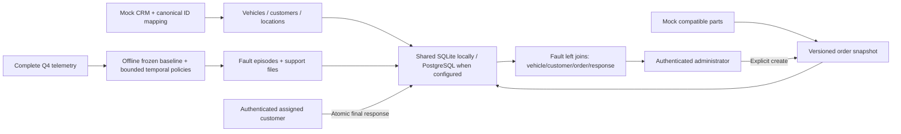

# Architecture, domain and migration

FleetCare — Predictive Maintenance remains public/package version 1.0.0 with app.py at repository root.
The current application has two primary workspaces, not a parallel/versioned application.

`simulation.py` generates source observations and usage; `temporal.py` defines observed interval support
and shared counters. `detection.py` contains frozen-regression inference, trusted incremental window checks,
a bounded batch trace, and stable episode extraction. `pipeline.py` processes every source partition offline,
bundles every episode's support and records provenance. `evaluation.py` is separate from operational data.

`storage.py` provides SQLite and PostgreSQL adapters; `database.py` applies versioned offline PostgreSQL migrations.
`service.py` owns shared storage, migration, authorized queries, explicit work-order creation, recommendation
snapshots and atomic responses. `auth.py` verifies PBKDF2 credentials and server-controlled identity mappings.
An opaque session token is hashed in the store, expires after eight hours, and resolves to the enabled user's
current authoritative role/customer on every service call. UI identity is never an editable role dropdown.
Default public demo credentials are synthetic and intentionally known; private configuration replaces them.
No production identity-provider/SSO claim is made.

`ui.py` renders Fault overview for administrators and Work order overview for assigned customers (administrators
may inspect all). Native dataframe single-row selection opens nested details. The admin fault detail has
Time series & evidence, Recommended actions, Parts list tabs; the customer order foregrounds exported
recommendations/parts and the technical response, with evidence secondary. Mutable tenant data is not globally
cached. Refresh requeries the database. Filters and fault page position are preserved on back navigation.

One source fault episode has one stable fault ID. Repeated episodes after observed recovery have separate IDs.
`faults LEFT JOIN vehicles/customers LEFT JOIN work_orders LEFT JOIN work_order_responses` retains one row
per fault; unique fault/order and response/order constraints prevent join multiplication. Work-order creation
status is Not created/Pending/Created/Failed. Work-order lifecycle is Open/Completed/Rejected. Fault status is
Active/Ended/Unknown and remains evidence-derived. Reported resolution and sensor verification are separate.
End markers require actual observed recovery; neither a completion date nor the end of a file implies recovery.

Creation is an authenticated administrator action. Detection imports no order/export request. A transactional
request records the snapshot, customer, attempts and error; a failed mock export leaves no successful order.
Retry uses the original snapshot and stable fault identity. Rejected orders do not silently reissue. Customer
responses validate ownership again inside the transaction, insert the final technical/decision payload, update
order status and append audit atomically. Identical final retries return the saved response; conflicts raise
an error rather than overwrite it. Responses do not reserve/consume stock, operate ERP, change sensor records,
reset components, or interpret notes as simulation controls. Actual part quantities are customer reports.

SQLite uses WAL, foreign keys, a 30-second busy timeout and BEGIN IMMEDIATE transactions. PostgreSQL
uses psycopg 3, remote TLS, autocommit connections with explicit transaction blocks, transaction-local
search paths/timeouts and a schema-scoped advisory transaction lock. The lock retains the same modest
serialized writer model, including seeding and final responses; this is not a high-throughput architecture.
Prepared statements are disabled for compatibility with pooled transaction connections. Returned rows
and bound SQL parameters share the same service/query interface, tested against both actual engines.

The PostgreSQL schema is isolated under `fleetcare`. Migration 001 runs offline through a direct URL;
runtime verifies the migration marker and uses a pooled URL without issuing schema DDL. Prepared reference
records import idempotently in batches, preserving work orders, responses and snapshots. Invalid/missing
remote configuration fails closed instead of opening an empty local store. Runtime errors do not print URLs.
A closed connection reconnects; a failed read can retry once. Writes are not automatically replayed when
commit outcome is uncertain. Unique keys and normalized response payloads make explicit retries safe.

SQLite is intended for local/single-instance review. Hosted SQLite durability is not promised. Configured
PostgreSQL persists operational history independently of Streamlit restarts and sessions; this was tested
on a separate Neon branch, including a fresh process. Only small operational/reference records go to the
database; prepared charts/telemetry remain in the repository. Auth remains the existing server-controlled
credential mapping; Neon Auth, Functions, Object Storage and Data API are not required or enabled.

## Additive migration

Legacy incidents, orders, feedback, observations, inventory, components, outbox and original audit remain
in place. Migration imports linked historical fault/order identities without deleting source rows. Legacy
created/assigned/in_progress become Open, completed becomes Completed, cancelled becomes Rejected with its
legacy cancellation state retained. No customer rejection reason or missing final response is fabricated.
Legacy feedback remains separately readable to administrators. A legacy resolution without a precise observed
end is labelled accordingly rather than inventing an end date. Schema completion is marked transactionally
and restart does not duplicate imported records. Existing audit rows retain their original values.

Future ServicePlan/FleetPulse contracts remain in contracts.py and config/shared-contracts.json. No scheduling,
health/peer scoring engine, real CRM/ERP integration, customer notification or hosting deployment is included.
