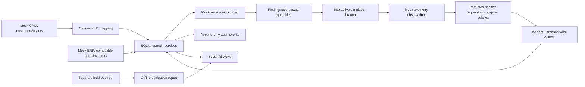

# Architecture and linked domain

FleetCare is an independent, entirely synthetic portfolio demonstration by Enamul Haque.
It uses explicit linked entities/actions/constraints, not proprietary platform software.

`config.py` validates settings and defines versioned synthetic policies. `simulation.py` produces
observations and independent hidden capacity losses. `ingestion.py` joins CRM IDs and maps ERP
compatibility. `detection.py` consumes only observed features plus persisted regression coefficients.
`service.py` owns lifecycle, inventory, outbox, feedback and replay checkpoint transactions.
`ui.py` renders operational data and the immutable evaluation summary. `evaluation.py` is an offline
CLI and is never imported by the UI. Operational inference never reads `evaluation/truth.json`.

Customer → Vehicles → VehicleModel; Vehicle → five family ComponentInstances → Observations;
FaultDefinition → versioned Playbook → Compatibility → Part/InventoryPosition;
Incident → WorkOrder → WorkOrderLines → Feedback → ServiceEvent (feedback completion audit);
UsageSummary → future ServiceCounter/MonthlyHealthRecord. Historical ServiceEvents are delivered as
`service_history.parquet`. Shared model schemas are in `contracts.py`; monthly scores are not generated.

Every incident stores baseline, policy and playbook versions, canonical vehicle/component IDs,
measured evidence and UTC event time. Source tables preserve source/version columns and file checksums.
Audit time distinguishes processing time from the operating clock. Repairs do not reset vehicle counters.

SQLite savepoints make observation checkpoints, incident creation and outbox writes atomic. Replay
checkpoints wrap nested ingestion in the same outer transaction. The mock receiver and acknowledgement
share a local transaction; the unique incident idempotency key protects receiver order creation. This
is a demonstration of outbox semantics, not a claim of a deployed external integration. A real receiver
must independently enforce the same key across an HTTP/network acknowledgement failure.

Unique observation keys protect repeated inputs; unique feedback/receipt keys reject conflicting
retries; reservations and consumption are ledgered separately. Cancelling returns reservations.
Severity escalates on an existing incident/order; recovery needs 15 eligible operating minutes.
Completion alone never resolves an incident. Recurrences link to the prior resolved incident; notification
cooldown suppresses warning noise but critical recurrence still notifies. Notifications are audit labels,
not real messages. Sensor errors/missingness remain unknown quality states.

Replay is manual, deterministic and bounded to staged windows. Repair efficacy depends on the selected
cause/action, with a configurable partial scenario, rather than switching to a prepared recovery track.
Only the affected sensor is regenerated; event context, other channels and lifetime counters are preserved.
The simplified family component instance records replacement age; individual subassembly physics are not
claimed. Offline evaluation files never change when a visitor records feedback. A proposed policy change
must receive a new version, development evaluation, and untouched holdout before promotion; feedback does
not automatically retrain/promote anything.

Default session state holds an independent in-memory SQLite connection per visitor. Only immutable
Parquet tables are cached globally. Reset discards that visitor's state. Local mode opens a specified
SQLite file, persisting replays, feedback, inventory and audit across process restart. Local mode is for
a single trusted operator, not a multiuser hosted database. No external durable backend is implemented.
